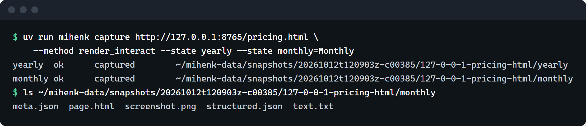
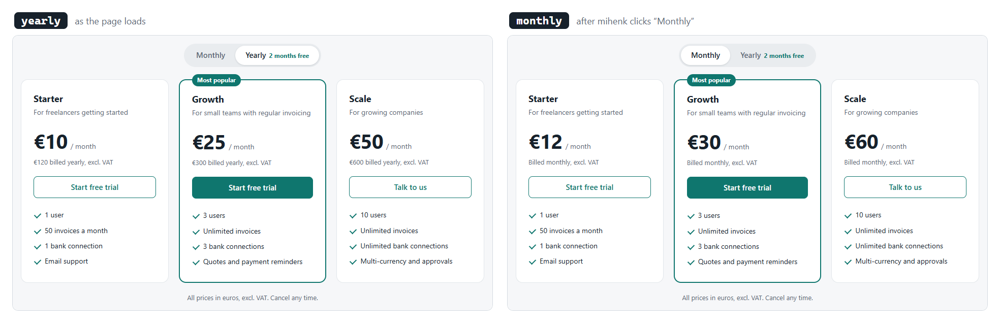
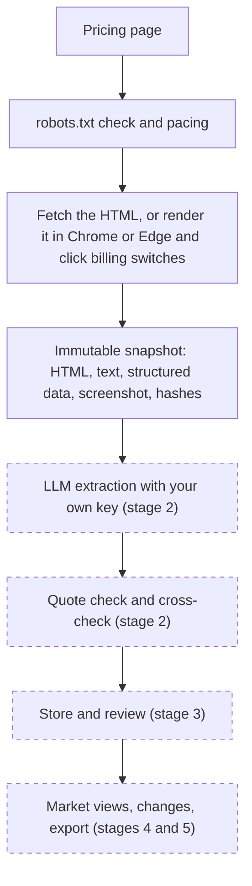

# mihenk

**A desktop app for tracking competitors' pricing pages, designed so that every price it reports
is checked against the page it came from.**

mihenk is for tracking competitors' **pricing and packaging**: the plans, prices, billing terms,
limits and features of SaaS-style products. It is built for the work of pricing, product marketing
and commercial teams. You point it at vendors' pricing pages, and it captures each page into a
snapshot that is never changed afterwards. In the finished app, an LLM reached through your own API
key reads the plans from each snapshot, and the core promise is this: every number mihenk shows is
checked against a verbatim quote from the page it came from.

The name is Turkish for touchstone (*mihenk taşı*), the stone used to test gold.

[](https://github.com/maydinidil/mihenk/actions/workflows/ci.yml)
[](https://github.com/maydinidil/mihenk/actions/workflows/build.yml)
[](LICENSE)


## Status

**Stage 1 of 6 is done:** a working capture engine, run from the command line with
`mihenk capture`. There is no release to install yet.

## Screenshots



A real `mihenk capture` run against a demo pricing page served locally (127.0.0.1). Each billing
state gets its own snapshot folder (the data folder is shortened to `~/mihenk-data` here).



The two screenshots mihenk saved in that run, cropped to the plans. For `monthly`, mihenk clicked
the page's "Monthly" switch before capturing.

The demo page is [`docs/demo/pricing.html`](docs/demo/pricing.html); Ledgerly is a made-up
product. Each snapshot folder also holds a `meta.json`. Trimmed, the one for the monthly state reads:

```json
{
  "captured_at": "2026-10-12T12:09:10Z",
  "files": {
    "page.html": "1e099005484acfb950628a058ddd868bed2e2995d70ca9058b381b7fa736a058",
    "screenshot.png": "45764a4e70c0b0decc6b360fda950979fafc507adad2828b2ea284fdab242a07",
    "text.txt": "25c97b75c0482409853b8f6fc4f471632eed02f33b72c6419be903d108ccdf9b"
  },
  "http_status": 200,
  "locale": {
    "currency_symbols": ["€"],
    "html_lang": "en",
    "vat_phrases": [{ "kind": "excl", "language": "en", "phrase": "excl. VAT" }]
  },
  "method": "render_interact",
  "state_label": "monthly",
  "url": "http://127.0.0.1:8765/pricing.html"
}
```

## What works today

Stages 0 and 1: the foundation and the capture engine. No LLM is used yet.

| Part | What it does |
|---|---|
| `mihenk capture <url>` | Captures one page and prints, for each state, its result and where its snapshot went |
| Three capture methods | `fetch` reads the HTML as the server sends it; `render` opens the page in the installed Chrome or Edge and waits for its scripts; `render_interact` also operates the page first, such as clicking a billing switch, and saves one snapshot per state ("yearly", "monthly") |
| robots.txt and pacing | robots.txt is checked before every request, redirect hops included, and requests to one site are at least 2 seconds apart. A refusal is recorded as `blocked_by_robots` |
| Fetching | Limits on time, size and redirects (90 seconds, 15 MiB, 5 hops); text decoded the way browsers decode it, legacy Western and Turkish encodings included |
| What a snapshot keeps | The HTML, the visible text, embedded data (JSON-LD, Next.js and Nuxt data), a screenshot for rendered pages, the HTTP status, and locale signals: the page language, currencies and VAT wording in seven languages |
| Snapshots | One folder per state, written once and never changed, with a SHA-256 hash of every file in `meta.json` |
| Bot checks | A page that answers with a bot check is recorded as `needs_human`; mihenk does not try to get past it |
| The desktop shell | The app window with its (still empty) screens, the local server and its guard, and a Windows installer and a macOS disk image, built and checked in CI (not published yet) |
| `mihenk install-browser` | Downloads Chromium, only after a yes, for a computer without Chrome or Edge |

To try the capture engine from source, install [uv](https://docs.astral.sh/uv/), run `uv sync` in
the repository, then `uv run mihenk capture <pricing page URL>`. The render methods need Chrome,
Edge, or the Chromium from `mihenk install-browser`. Capture only pages you may visit; mihenk
checks robots.txt by default.

## Coming next

Each stage gets its own plan, written after the previous stage lands.

| Stage | What it adds | Done when |
|---|---|---|
| 2. Extraction and checks | First, a capture fix found in the first live capture: prices drawn inside web components ([decision 0008](docs/decisions/0008-first-live-capture.md)). Then an LLM (OpenAI by default, Anthropic's Claude as the second choice, through the user's own API key, kept in the system's credential store) reads each snapshot and returns every value with a verbatim quote. Code then checks that the quote is really on the page and holds the number, the currency and the billing period; compares the visible text with the page's embedded data; and flags values that look wrong | Recorded LLM answers pass the quote check and the cross-check on every test page, and no value without a matching quote could reach a view |
| 3. Store and Review | A local database where records are only ever added, never changed; captures running inside the app, with live progress; a Review screen to accept or correct each value | A run's values are stored that way and reviewed in the Review screen |
| 4. Market views | A plans table and a features matrix across competitors; sorting plans and features into the user's own categories; custom fields; a Settings screen (LLM provider and key, model, capture conduct, country, data folder) | The market views work on the test pages and on one real market |
| 5. Changes, export, helper | What changed between two runs; export to CSV, JSON and Excel; a helper that sets up a new brand's page and finds its billing switches; workspace import and export; an update check | Two runs are compared, and the Excel export matches the JSON export |
| 6. Public beta | A privacy notice, a licences screen, the download page, a script that checks captures still work on live pages, and the release workflow | Installers for Windows and macOS (not yet code-signed) and the Python package are on GitHub Releases |

## How it works

Dashed boxes are not built yet.



## Engineering highlights

- **A local-only server.** The screens talk to a FastAPI server bound to 127.0.0.1. One guard runs
  before every route and checks the Host and Origin headers and a secret key created fresh at each
  launch. FastAPI's own docs pages are off, and every response carries a strict Content Security
  Policy ([`src/mihenk/api/security.py`](src/mihenk/api/security.py)).
- **Polite capture.** robots.txt is checked on every hop, requests to one site are paced, there are
  no logins, and bot checks are never bypassed.
- **Immutable, hashed snapshots.** Each snapshot is written to a temporary folder and renamed into
  place in one step, and its `meta.json` holds a SHA-256 of every file
  ([`src/mihenk/capture/snapshot.py`](src/mihenk/capture/snapshot.py)).
- **The browser's own traffic switched off.** Chrome and Edge contact their makers' services while
  they run (sign-in checks, push messaging, component updates). mihenk launches them with those
  services off, measured before and after; what Edge still sends is written down
  ([decision 0007](docs/decisions/0007-browser-own-traffic.md)).
- **Tests never leave the machine.** A guard in [`tests/conftest.py`](tests/conftest.py) allows
  only connections to this machine and refuses to look up any other host name, and the browsers
  the tests start are confined to 127.0.0.1 (one known gap, with Edge, is recorded in decision
  0007). The capture tests run against 19 small made-up "trap pages", each reproducing something
  that breaks a capture: a page that never goes quiet, a legacy Turkish encoding, a huge data
  block, a bot wall, VAT wording in seven languages.
- **About 1,500 Python tests**, plus tests for the screens. CI runs every check on Windows and
  macOS; the Build workflow makes the Windows installer, the macOS disk image and the Python
  package, and starts each built app once as a release check.
- **Licences checked.** Every shipped dependency is checked against a licence allow-list, and
  every build includes a third-party notices file
  ([`tools/check_licenses.py`](tools/check_licenses.py), [`tools/gen_notices.py`](tools/gen_notices.py)).
- **No arithmetic on prices.** A lint
  ([`tools/check_price_arithmetic.py`](tools/check_price_arithmetic.py)) refuses arithmetic on
  price fields: prices are to be copied from pages, never calculated. It runs in CI already,
  before the first price field arrives in stage 2.
- **Decisions on record.** Every decision taken during the build has its own file in
  [`docs/decisions/`](docs/decisions/), including what did not work in the first live capture
  ([decision 0008](docs/decisions/0008-first-live-capture.md)).

## Built with

| Tool | Used for |
|---|---|
| Python 3.13 | The app, the capture engine and the build tools |
| FastAPI | The local server behind the screens |
| Playwright | Driving the installed Chrome or Edge |
| React and Vite | The screens, in TypeScript |
| pywebview | The app window |
| PyInstaller | The frozen app inside the Windows installer and the macOS disk image |
| uv | One locked Python environment, the same on every machine and in CI |

## Where things are

| Where | What |
|---|---|
| [`docs/superpowers/specs/2026-10-08-mihenk-design.md`](docs/superpowers/specs/2026-10-08-mihenk-design.md) | The approved design |
| [`docs/superpowers/plans/2026-10-08-mihenk-stages-0-1.md`](docs/superpowers/plans/2026-10-08-mihenk-stages-0-1.md) | The plan for stages 0 and 1, ending with the roadmap for stages 2 to 6 |
| [`docs/planning/`](docs/planning/) | The record of each finished stage: rulings made and work carried forward |
| [`docs/decisions/`](docs/decisions/) | Decisions taken during the build, one file each |
| [`docs/demo/pricing.html`](docs/demo/pricing.html) | The made-up pricing page the screenshots were taken from |
| [`CHANGELOG.md`](CHANGELOG.md) | What changed, release by release |

## Licence

mihenk is **source-available**, not open source. It is licensed under the
[PolyForm Noncommercial License 1.0.0](LICENSE).

| Question | Answer |
|---|---|
| Can I use it for study, research, a hobby, a school, a charity or a public body? | Yes, any non-commercial purpose |
| Can a company use it in its business? | Not under this licence. A commercial licence is needed |
| Can I try it at work first? | Yes, for up to 30 days from first use, to decide whether to keep using it or ask for a commercial licence. See [`EVALUATION.md`](EVALUATION.md) |
| Do I have to credit the author? | Yes. Anyone who passes mihenk on must pass on the lines in [`NOTICE`](NOTICE) |
| Where do I ask for a commercial licence? | Through [github.com/maydinidil](https://github.com/maydinidil) |

The full terms are in [`LICENSE`](LICENSE). This summary is a convenience and does not replace them.

## Checks

These are the checks the project uses. Run them from the repository root; CI runs the same
commands on Windows and macOS.

| Check | Command |
|---|---|
| Python format and lint | `uv run ruff format --check . && uv run ruff check .` |
| Python types | `uv run mypy` |
| Python tests | `uv run pytest` |
| Screens | `cd web && npm run lint && npm run typecheck && npm test && npm run build` |
| API types up to date | `uv run python tools/dump_openapi.py && (cd web && npm run gen:api) && git diff --exit-code web/openapi.json web/src/api/schema.ts` |
| Licences | `uv run python tools/check_licenses.py` |
| No arithmetic on prices | `uv run python tools/check_price_arithmetic.py` |

To set up the Python environment, install [uv](https://docs.astral.sh/uv/) and run `uv sync`. It
fetches Python 3.13 and the locked dependencies. The browser tests use the installed Chrome or
Edge and are skipped when neither is found; CI sets `MIHENK_REQUIRE_BROWSER=1`, so there they must
run. Building the screens needs Node.js 24.
